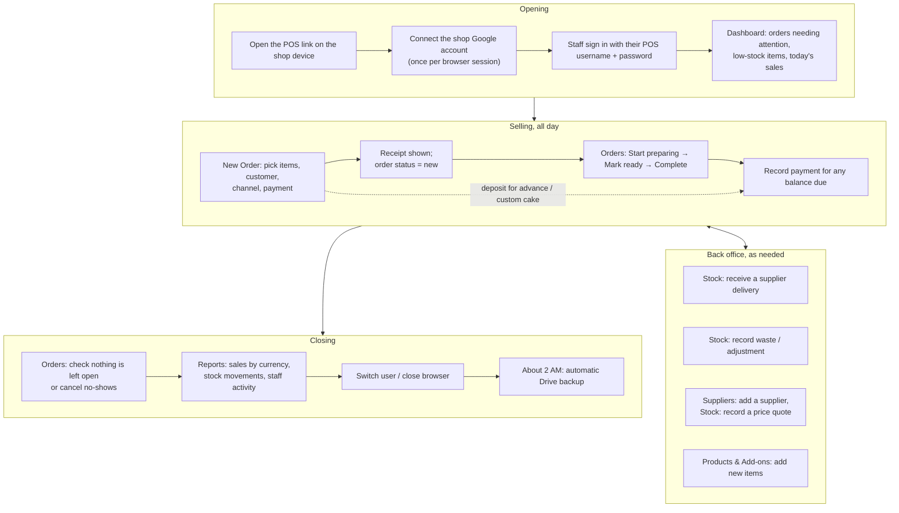

# 0. A day in the shop (end to end)

How the screens fit together in a normal working day. Each box links to a detailed process.

## Detailed processes

1. [Sign in, roles and page access](01-sign-in-and-roles.md)
2. [Take a new order](02-take-a-new-order.md)
3. [Order lifecycle](03-order-lifecycle.md)
4. [Record a payment](04-record-a-payment.md)
5. [Products and add-ons](05-products-and-addons.md)
6. [Suppliers and stock](06-suppliers-and-stock.md)
7. [Dashboard and reports](07-dashboard-and-reports.md)
8. [Staff accounts and settings](08-staff-and-settings.md)
9. [Working offline](09-working-offline.md)
