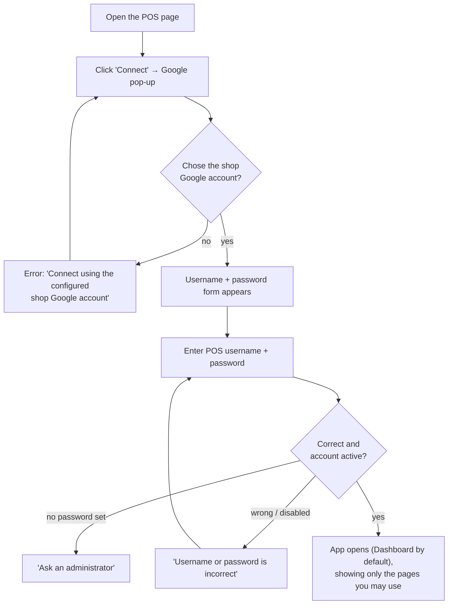
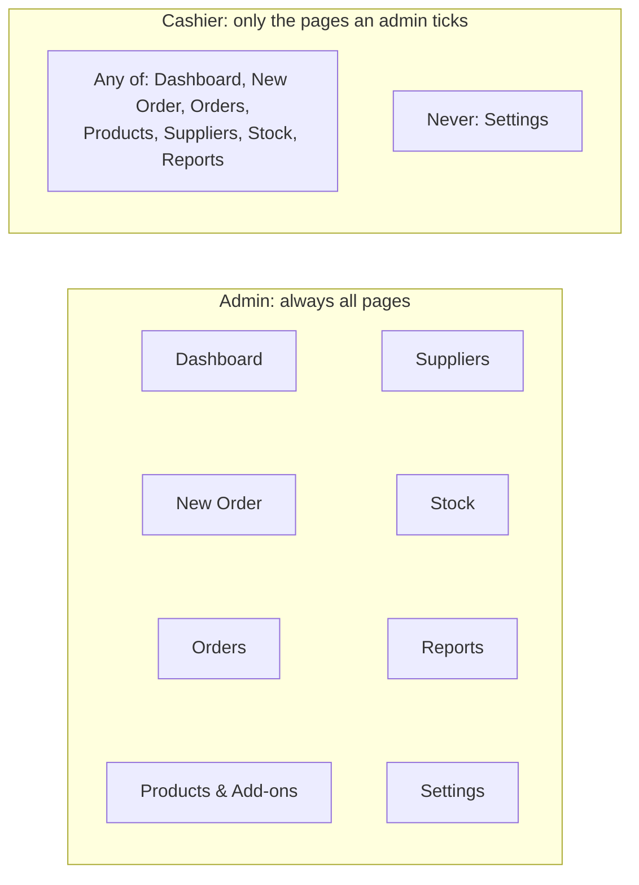

# 1. Sign in, roles and page access

## Signing in

Staff don't need their own Google account. The **shop** Google account is connected once in each browser, and everyone then uses their own POS login.

## Changing who is at the till

| Button | When to use it | What happens |
|--------|----------------|--------------|
| **Switch user** | Shift change, or a colleague takes over | You are signed out of the POS. The shop Google connection stays, so the next person only types their username and password |
| **Change Google account** | The wrong Google account was connected | The Google connection is removed. Connect again, then sign in |

You are signed out automatically **after 6 hours**, or straight away if an admin changes your password or disables your account.

## Roles and pages

- Pages you can't use are hidden in the menu, and the server refuses them as well.
- Only admins see **staff activity** in Reports.
- At least one active admin must always exist. An admin cannot remove their own admin access.
