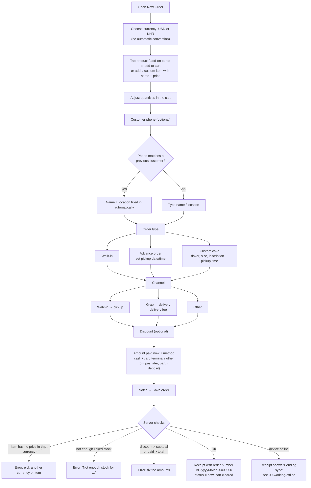

# 2. Take a new order

**Page:** New Order. **Who:** cashier or admin with the `new-order` page.



## How the total is calculated (on the server)

```
subtotal  = Σ (unit price × quantity)          prices come from the catalog, not the screen
tax       = (subtotal − discount) × tax rate    tax rate is set in Settings
total     = subtotal − discount + tax + delivery fee
balance   = total − payments received
```

## Rules to know

- An order needs **at least one item**.
- Each catalog item must have a price in the chosen currency.
- A **Grab** order is always delivery, and a **walk-in** order is always pickup.
- Products linked to stock (for example ready-made cakes) **reserve stock** as soon as the order is saved.
- Customers are remembered by phone number from past orders. There is no separate customer list to maintain.
