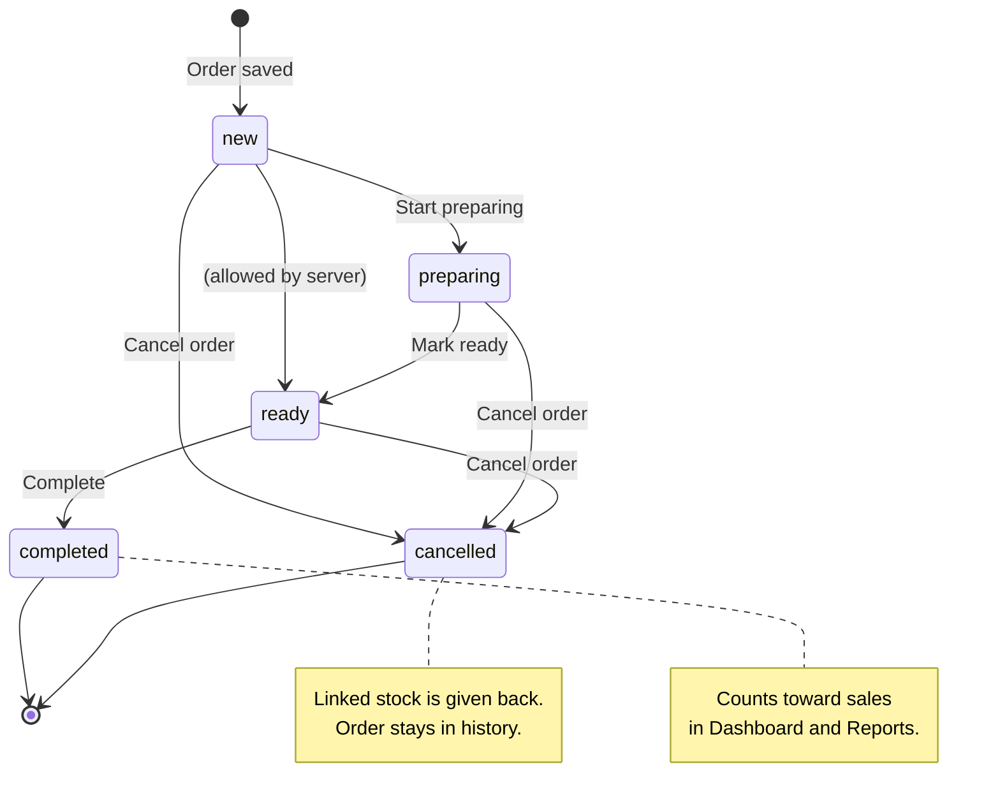
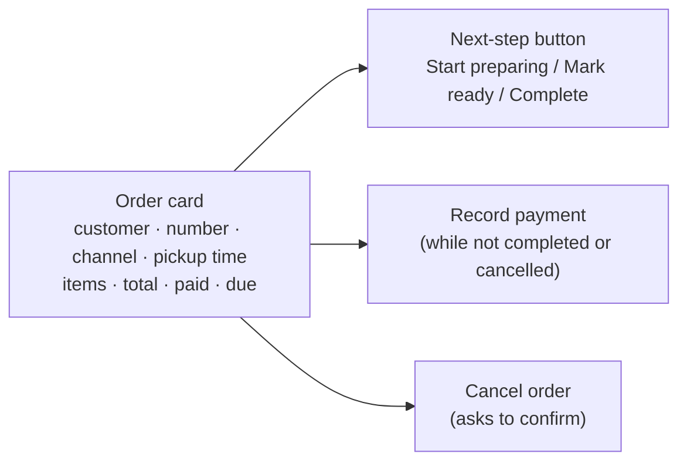

# 3. Order lifecycle

**Page:** Orders (and the Dashboard "needs attention" list). **Who:** staff with the `orders` page.

## What staff do on each order card

## Finding orders

- When the app opens, the list shows **yesterday and today**, plus **any older order still open**. This means advance orders for later dates are not lost.
- Use the date range (up to **31 days**) and the status filter to search history. The summary shows totals per currency and leaves cancelled orders out.
- Every status change is time-stamped (`OrderStatusHistory`) and recorded in the staff activity log.

## Rules

- Completed and cancelled orders are final and cannot be changed.
- Cancelling an order **does not refund** payments. Refunds are not built, so handle them outside the POS.
