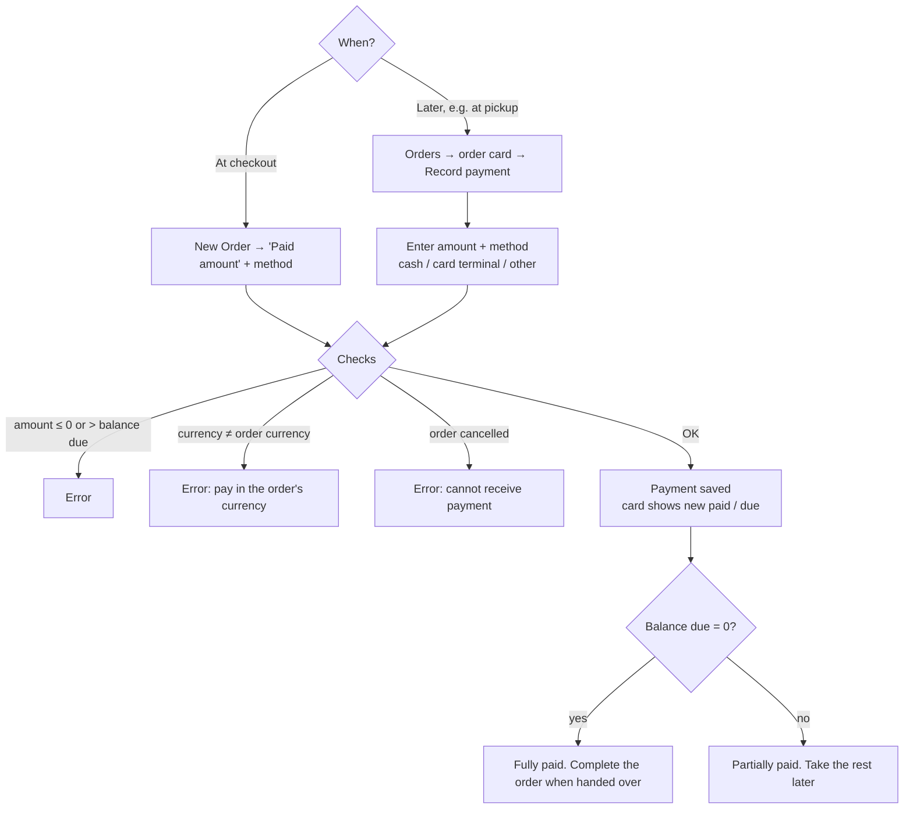

# 4. Record a payment

Payments can be taken **when the order is created** (full payment or deposit) and/or **later** from the Orders page.

## Typical cases

| Case | At checkout | Later |
|------|-------------|-------|
| Walk-in, pays now | Paid = total | — |
| Advance order with a deposit | Paid = deposit | Rest at pickup |
| Custom cake, pay on collection | Paid = 0 | Full amount at pickup |

## Limits

- No card details are ever entered. "Card terminal" only records that a separate machine took the payment.
- No currency mixing: a USD order is paid in USD.
- Refunds are not built.
