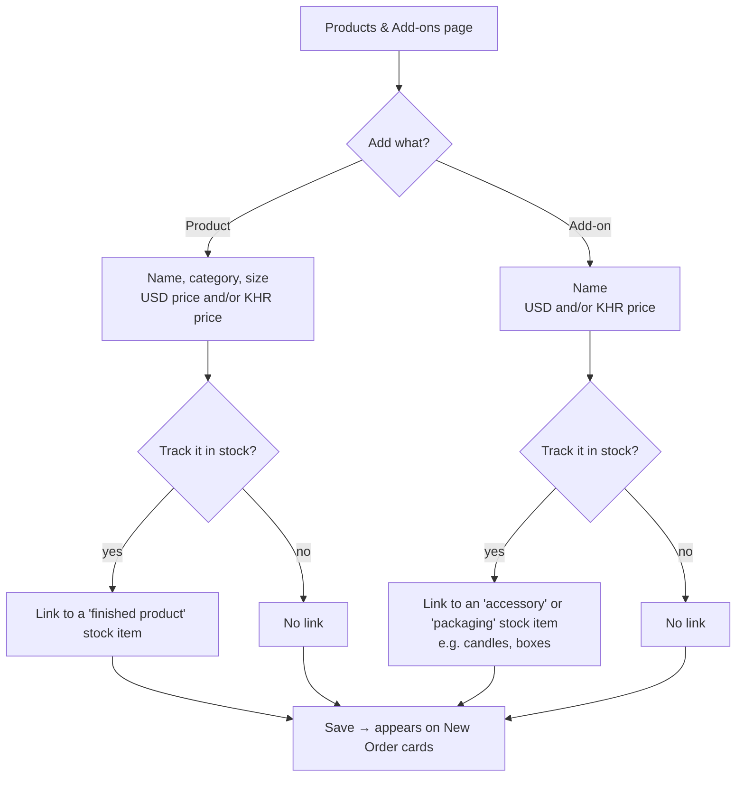

# 5. Products and add-ons

**Page:** Products & Add-ons. **Who:** admin or staff with the `products` page.

## Rules

- At least one price (USD or KHR) is required. An item with no price in a currency can't be sold in that currency.
- USD and KHR prices are **independent**. Nothing is converted automatically.
- To track a product's stock, first create the matching stock item on the **Stock** page with the right category.
- Order lines keep a **snapshot** of the name and price. Changing the catalog later does not alter past orders.

> Not in the app yet: editing or deactivating items. Today that is done by editing the `Products` / `AddOns` tab in the Sheet (set `active` to FALSE), then pressing **Refresh**.
