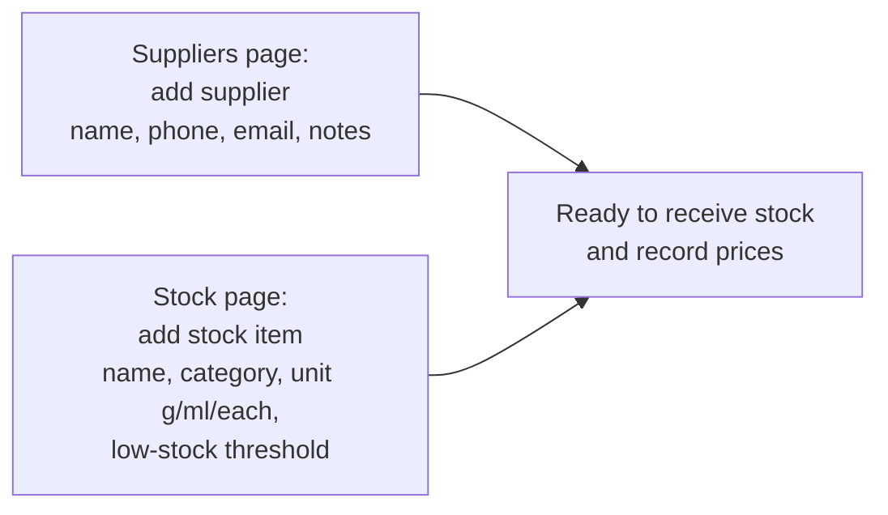
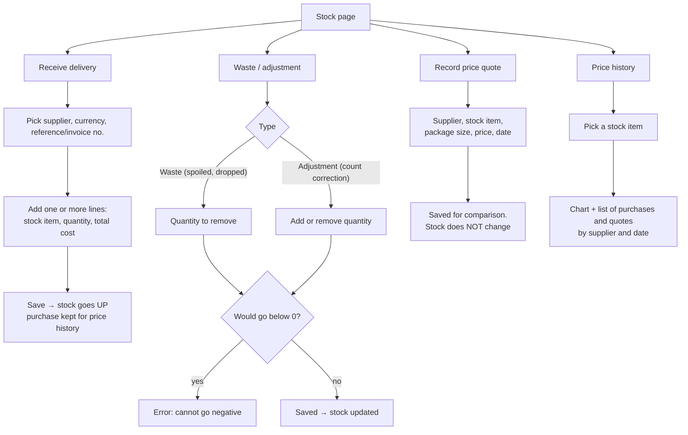

# 6. Suppliers, stock and price history

**Pages:** Suppliers, Stock & Price History. **Who:** admin or staff with those pages.

## Setting up

Stock categories: **ingredient** (flour, butter), **packaging** (boxes), **finished product** (cakes for sale, which can be linked to a product), **accessory** (candles, which can be linked to an add-on).

## Day-to-day stock tasks

## How stock changes automatically

| Event | Stock effect |
|-------|--------------|
| Order saved with a linked product or add-on | Goes down (reserved) |
| That order is cancelled | Goes back up |
| Order completed | No further change. The reservation was the sale |

Items at or below their **low-stock threshold** are flagged on the Stock page and the Dashboard.

> Not built: recipe-based use of ingredients. Selling a cake does not reduce flour. Record ingredient use with a **waste/adjustment** entry, or with regular stock counts.
