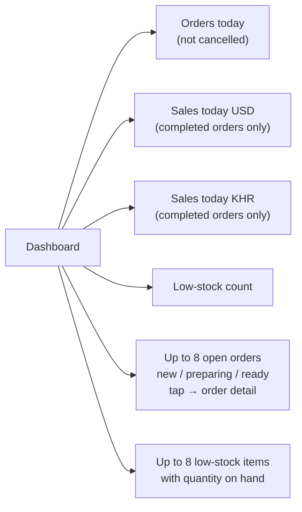
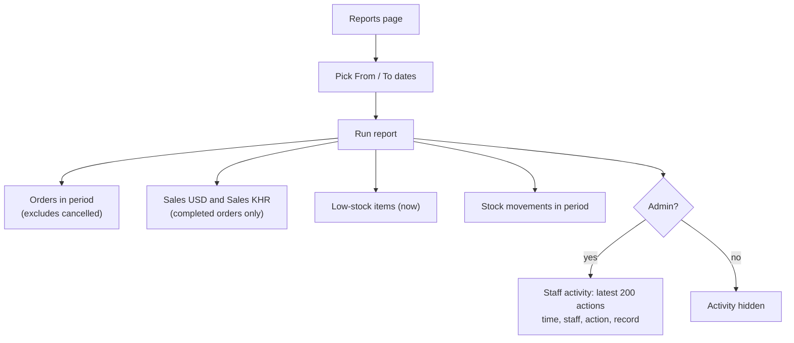

# 7. Dashboard and reports

## Dashboard: what needs attention right now

## Reports: a chosen period

## Reading the numbers correctly

- **Sales count only completed orders.** An order that is paid but not yet marked Complete is not in sales yet.
- USD and KHR are reported **separately** and are never added together.
- Staff activity shows who created or changed what (orders, payments, stock, staff, settings). It comes from `AuditLog`.

> Using the staff activity log to judge a staff member's performance or to discipline them is a people decision. It needs proper context and HR process, not just this log.
