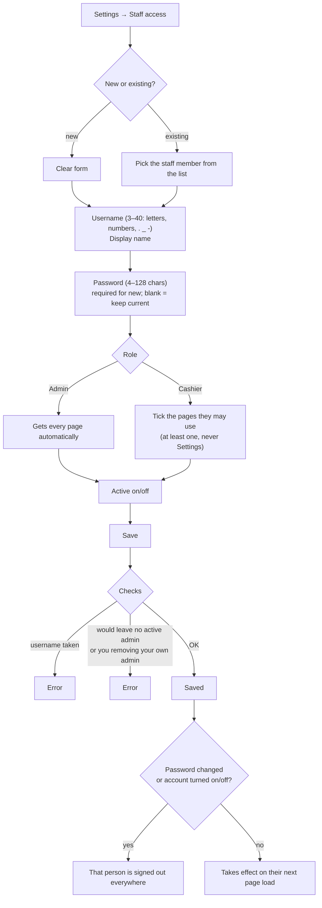

# 8. Staff accounts and settings

**Page:** Settings. **Who:** admin only.

## Add or change a staff account

## Shop settings

| Setting | Effect |
|---------|--------|
| Default currency (USD / KHR) | Currency picked automatically on New Order |
| Tax rate (basis points, 0–10000; e.g. 1000 = 10%) | Added to every new order: (subtotal − discount) × rate |

Backup retention (days) is read from the `Settings` tab by the backup project. It isn't set from this page.

## Good practice

- Give each person their **own** username, so the activity log stays meaningful.
- Passwords are visible to admins and are stored in plain text in the Sheet, so **never reuse a Google or personal password**.
- Disable leavers rather than deleting them, so that their past activity still has a name against it.
