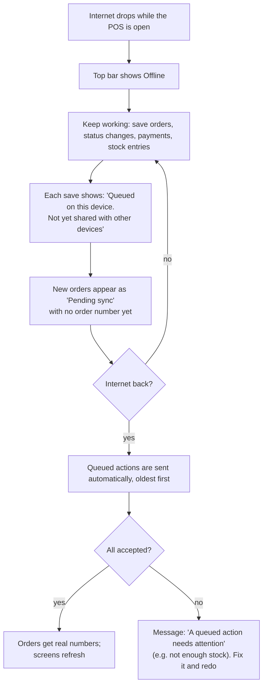

# 9. Working offline

The POS can keep taking orders through a short internet drop, **but only if it was already open and signed in** before the connection went down.

## Do and don't

| Do | Don't |
|----|-------|
| Keep the POS tab open during short outages | Close or reload the tab while offline. It won't open again until you're back online |
| Sign back in as the **same** user to send your queued actions | Expect other tills to see offline orders before they sync |
| Check the receipt says "Pending sync" and tell the customer | Hand over items reserved in stock without checking. Stock is only checked when the order syncs |

Queued actions are stored in this browser on this device only. Clearing the browser data before they sync loses them.
