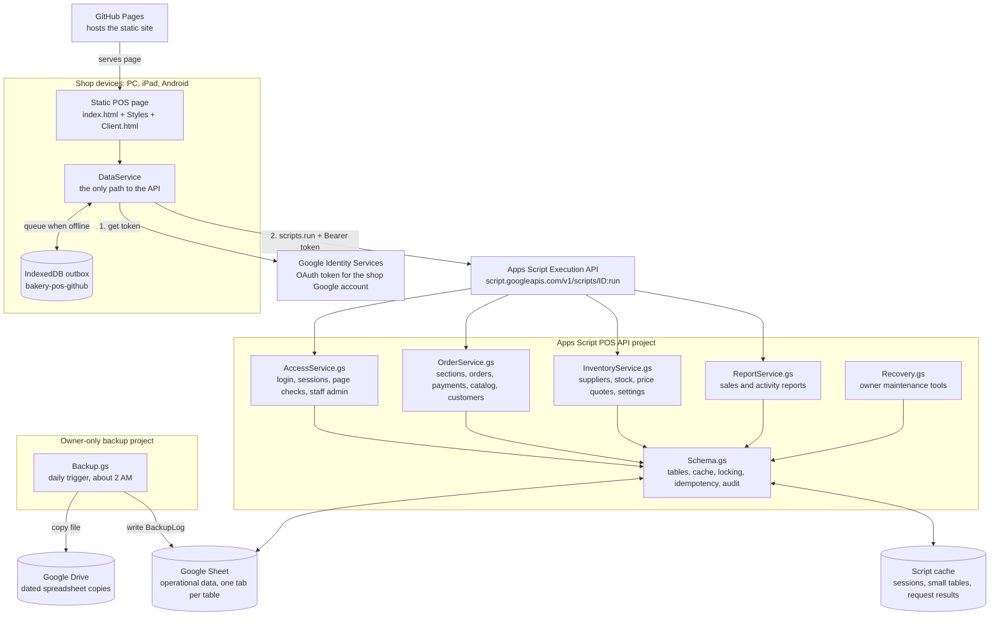

# 1. Architecture overview

The POS has four parts. A static web page runs on any device. An Apps Script project acts as the API and holds all the business rules. One Google Sheet stores all the data. A second, owner-only Apps Script project makes the daily backups.

## Who owns what

| Component | Responsibility | Does not do |
|-----------|----------------|-------------|
| Static client | Screens, Google connect, POS login form, progress messages, offline queue | Read or write Sheets directly |
| `DataService` (in `Client.html`) | Sends every `scripts.run` call, attaches the session token and the request ID for writes | Business rules |
| Apps Script POS API | Validation, totals, permissions, audit, all Sheet access | Host the UI |
| Google Sheet | Source of truth for every table (see [Data model](06-data-model.md)) | Transactions (locking is done in Apps Script) |
| Backup project | Daily Drive copy, retention cleanup, `BackupLog` rows | Anything a cashier uses |

## Key design points

- **No middle server.** The browser calls Google's Execution API directly with an OAuth token.
- **Two login layers.** The shop Google account comes first, then the POS username and password (see [Authentication](02-authentication-and-sessions.md)).
- **Updates by polling, not push.** Open screens refresh on focus, on return to the tab, and on the Refresh button.
- **Offline support is limited.** It only queues writes on a page that is already open. A fresh launch or reading data needs the internet.
