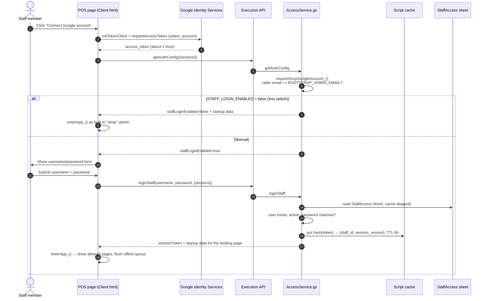
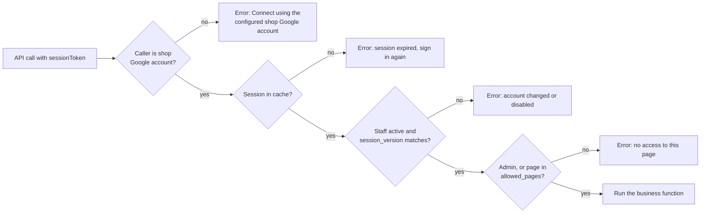

# 2. Authentication and sessions

Sign-in has two layers.

1. **Shop Google account (always on).** The browser gets an OAuth access token through Google Identity Services. On every call, the API checks that the caller's email matches the `BOOTSTRAP_ADMIN_EMAIL` Script Property (`requireShopGoogleAccount_`).
2. **POS staff login.** The staff member enters a username and password, which are checked against the `StaffAccess` tab. The server returns a random session token. It is stored in the script cache under its SHA-256 hash and lasts 6 hours.

## Check on every protected call

## How a session ends

| Event | Effect |
|-------|--------|
| 6 hours pass, or the cache evicts the entry | The next call fails with "session expired" |
| Admin changes the user's password or enables/disables the account | `session_version` goes up, so every open session for that user is rejected |
| User clicks **Switch user** | `logoutStaff` removes the cache entry, and the page returns to the login form |
| User clicks **Change Google account** | The OAuth token is revoked in the browser, and both layers have to be done again |

> Security note from `docs/ARCHITECTURE.md`: this login identifies which staff member did what. It does not keep staff securely apart. POS passwords are stored in plain text in `StaffAccess`, and the shop's OAuth token is present in the browser.
