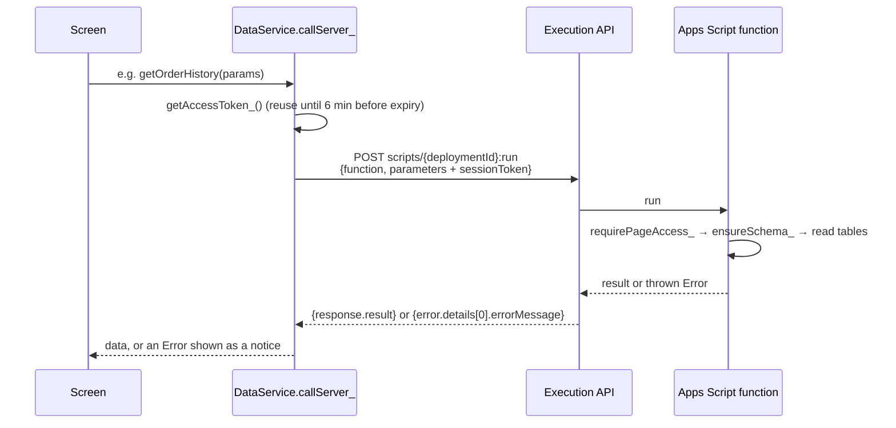
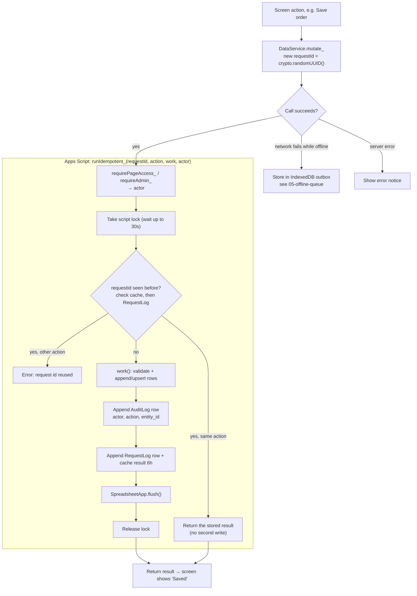

# 3. API call and safe writes

Every read and write takes the same route: `DataService` → Execution API → Apps Script function. Writes ("mutations") also run through `runIdempotent_` in `Schema.gs`. It holds a script lock, uses the request ID so a retry is never applied twice, writes the audit row and records the result.

## Read call

## Write call (idempotent)

## Write functions and the permission each needs

| Function | Page or role checked | Tables written |
|----------|------------------------|----------------|
| `createOrder` | `new-order` | Orders, OrderItems, OrderStatusHistory, Payments, StockMovements, StockLevels |
| `updateOrderStatus` | `orders` | Orders, OrderStatusHistory (+ StockMovements on cancel) |
| `recordPayment` | `orders` | Payments |
| `createProduct`, `createAddOn` | `products` | Products, AddOns |
| `createSupplier` | `suppliers` | Suppliers |
| `createInventoryItem`, `recordSupplierPriceQuote`, `receiveStock`, `adjustStock` | `stock` | InventoryItems, SupplierPriceQuotes, PurchaseReceipts, PurchaseLines, StockMovements, StockLevels |
| `updateSettings`, `updateStaffAccess` | admin | Settings, StaffAccess |

Every write above also adds rows to `AuditLog` and `RequestLog`.
