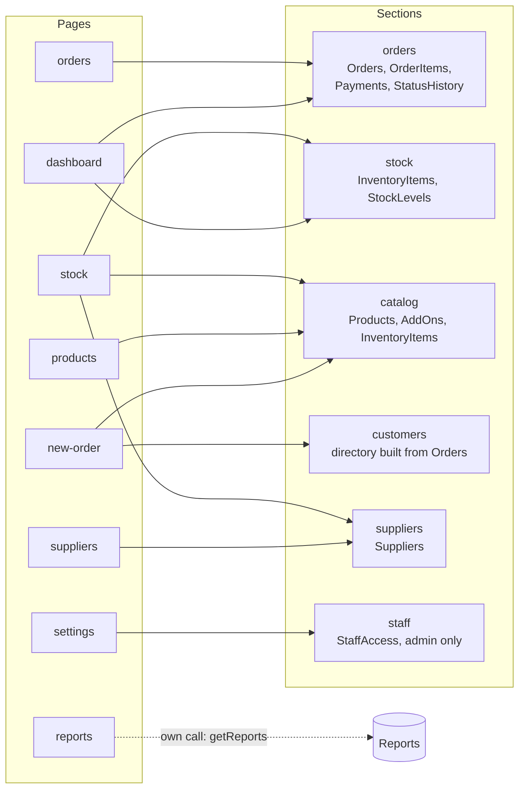
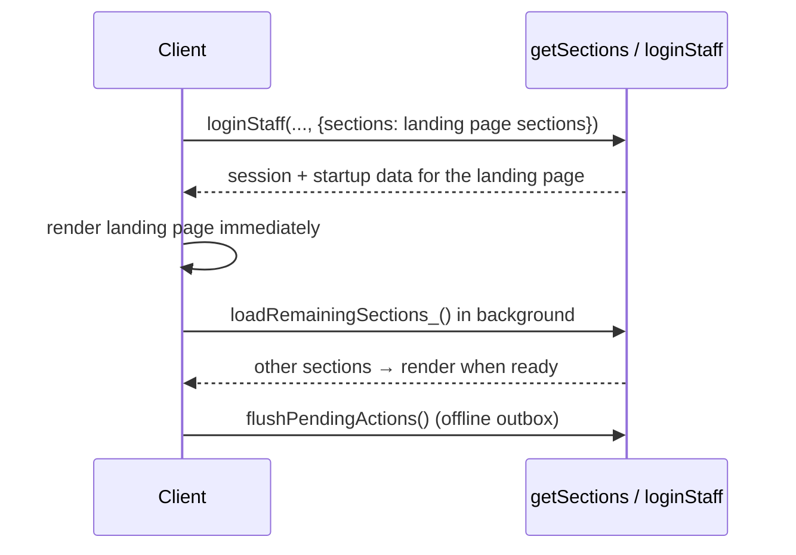

# 4. Data loading, caching and refresh

The client does not load everything at once. Each page asks only for the **sections** it needs. The page that is open loads first, and the other sections load in the background.

## Which data each page needs

The server filters the sections again with `canSeeSection_`, so a cashier never receives sections for pages they aren't allowed to use.

## Startup and background load

## Caches

| Layer | What is cached | How long | When it is cleared |
|-------|----------------|----------|--------------------|
| Per call (`tableMemo_`, `sheetMemo_`) | Sheets and tables read during this one call | One API call | Automatically, when the call ends |
| Script cache: small tables | Settings, Products, AddOns, Suppliers, InventoryItems, StaffAccess, StockLevels | 10 min | On every write to that table, or the **Refresh** button (`fresh: true`) |
| Script cache: schema check | "Tabs and headers are OK" flag | 6 h | When `SCHEMA_VERSION_` is bumped |
| Script cache: request results | Result of each write, keyed by request ID | 6 h | Expires (RequestLog is the permanent fallback) |
| Script cache: sessions | Staff session | 6 h | Logout, password change, enable/disable |

Edits made directly in the Sheet show up after **Refresh**, or within 10 minutes.

## Order date range

- On startup the client loads **yesterday and today**, plus any **older order that is still open** (new, preparing, ready).
- The Orders history search allows at most **31 days**, 300 orders per page, with optional status filter (`getOrderHistory`).

## Refresh triggers

- The tab becomes visible again, or the window gets focus (`refreshOnReturn_`).
- The **Refresh** button forces fresh data from the server.
- The device comes back online: the outbox is sent, then the data refreshes.
- After an order that uses linked stock items, the `stock` section reloads.
