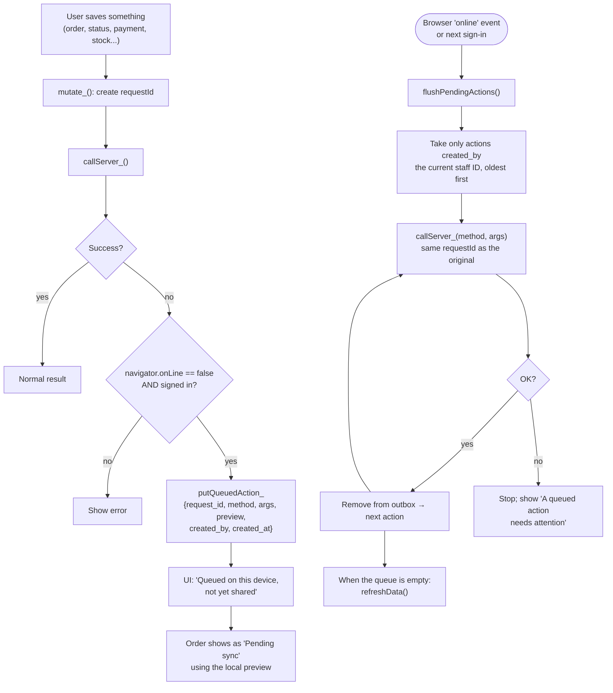

# 5. Offline queue and sync

If the device loses the internet while the POS is **already open and signed in**, writes are kept in an IndexedDB "outbox" on that device. They are sent in order once the device is back online.

## Rules and limits

- **Duplicate-safe.** Because the original `requestId` is sent again, the server returns the stored result if that request had in fact already arrived (see [Safe writes](03-api-call-and-safe-writes.md)).
- **Per staff member.** Only the signed-in staff member's own queued actions are sent. Another user's queue stays on the device until that user signs in.
- **Stops at the first failure,** so later actions that depend on it are not sent out of order.
- **Not supported offline:** starting the app, signing in, or loading or reading data.
- **Stock is checked at sync time,** not when the order was queued. A queued order can still be rejected for "Not enough stock".
