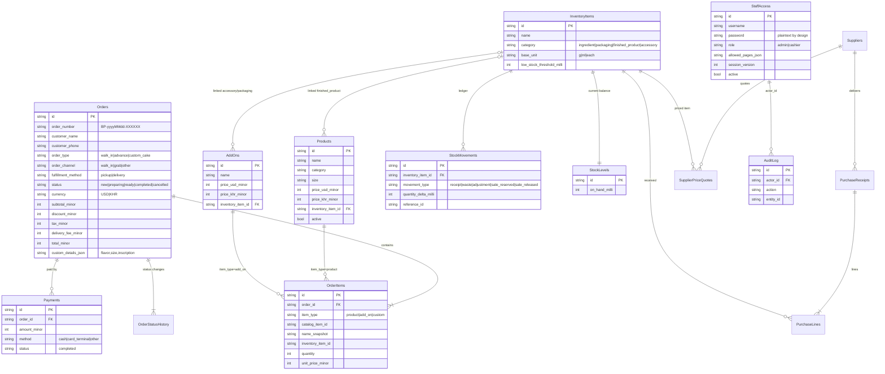

# 6. Data model (Google Sheet tabs)

Each table is one tab in the operational spreadsheet. `Schema.gs` (`TABLE_SCHEMAS`) defines the column order and checks it. Renaming or reordering columns stops the API. Money is stored as integer minor units (USD cents, whole KHR riel). Quantities are stored ×1000 (`_milli`).

## Support tables (no relationships drawn)

| Tab | Purpose |
|-----|---------|
| `Settings` | `default_currency`, `tax_rate_basis_points`, `supported_currencies`, `backup_retention_days` |
| `RequestLog` | One row per successful write (request ID → stored result), used for duplicate-safe retries |
| `BackupLog` | Written by the backup project: file ID, name, status, message |

## Customer directory

Customers are not stored in a table of their own. `getCustomerDirectory_` builds them from `Orders`, grouped by phone number (digits only, at least 5). It keeps the latest name and location and counts the orders.
