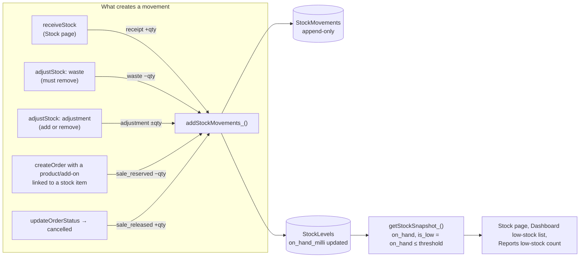

# 7. Stock ledger

Stock is never typed in as a number. It is a **ledger**: every change is a row in `StockMovements`, and `StockLevels` keeps the running balance for each item, so the app doesn't have to add up the whole history on every read.

## Guards

| Rule | Where |
|------|-------|
| An order is refused if a linked stock item doesn't have enough on hand | `validateLinkedStock_` in `createOrder` |
| A removal adjustment cannot make the balance negative | `adjustStock` |
| Waste can only remove stock | `adjustStock` |
| Products can link only to a `finished_product` stock item. Add-ons can link only to `accessory` or `packaging` | `createProduct`, `createAddOn` |
| A receipt needs an active supplier, at least one line, and a cost above zero | `receiveStock` |

## What is not built

- Recipe-based ingredient consumption: selling a cake does not reduce flour or sugar.
- Stock for a **completed** order stays reserved. The `sale_reserved` movement *is* the deduction, and only cancelling an order releases it.

## Repair

If `StockLevels` drifts from the movements (for example after hand edits to the Sheet), the owner runs `rebuildStockLevels()` from `Recovery.gs` to recalculate every balance from `StockMovements`.
