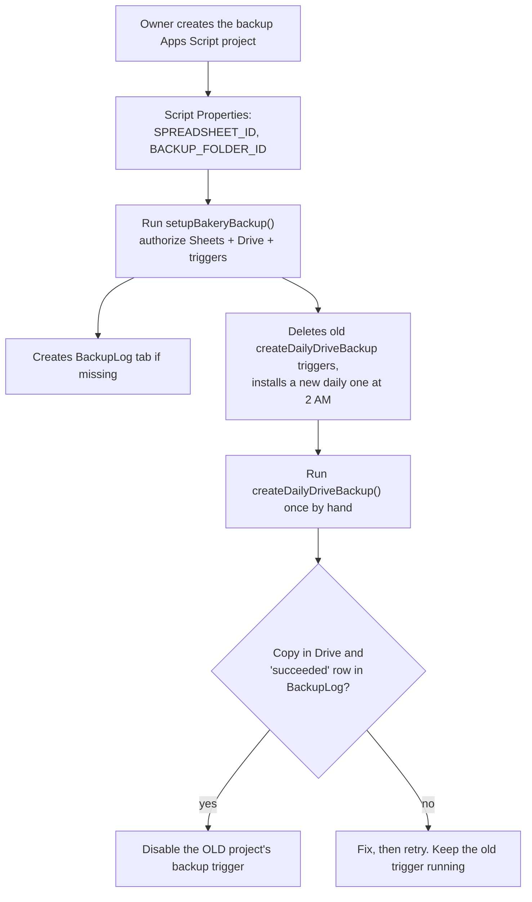
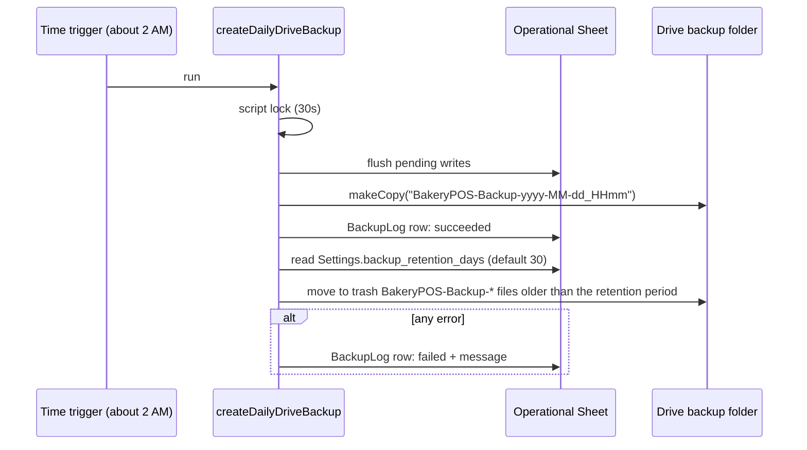

# 8. Backup and recovery

Backups run in a **separate, owner-only** Apps Script project (`apps_script_backup/Backup.gs`). The point of the separation is that cashiers are never asked to authorize Drive or trigger permissions.

## One-time setup

## Daily run

## Owner recovery tools (`apps_script/Recovery.gs`, run from the editor)

| Function | Use it when |
|----------|-------------|
| `diagnoseApi()` | Sign-in or the API fails. It checks each step in turn: Script Properties, active user email, shop-account match, cache, lock, opening the spreadsheet, the `StaffAccess` tab, and whether batch reads (the Sheets advanced service) are on. It changes nothing |
| `restoreStaffAccessTab()` | The `StaffAccess` tab is missing or the admin is locked out. It recreates the tab and the `admin` row. Afterwards, type a new password into the Sheet by hand |
| `rebuildStockLevels()` | Stock balances look wrong |
| `clearPosCaches()` | Hand edits in the Sheet don't show up |

## Restoring data

Backups are whole-spreadsheet copies. To restore, open the dated copy and copy the tabs you need back into the operational Sheet. Then run `clearPosCaches()`, and run `rebuildStockLevels()` if stock tabs were restored.
