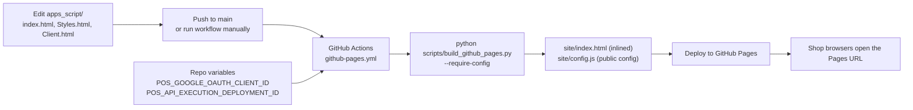
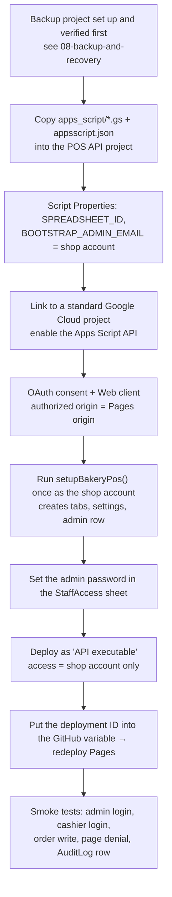

# 9. Build and deployment

## Release pipeline (UI)

The OAuth client ID and the deployment ID are public configuration, not secrets. Never put access tokens, client secrets or service-account keys into repo variables or the browser bundle.

## API deployment (Apps Script)

## Rollback

Keep the old Apps Script deployment and the spreadsheet untouched while the new setup is being tested. If something fails, revert or disable the Pages workflow and keep using the old deployment. Never remove the verified backup trigger as part of a rollback.

> Note: the folder `apps_script_before_speed_2026-11-28/` is a snapshot of the API source from before the speed changes. Nothing deploys it, so it can serve as a manual fallback.
